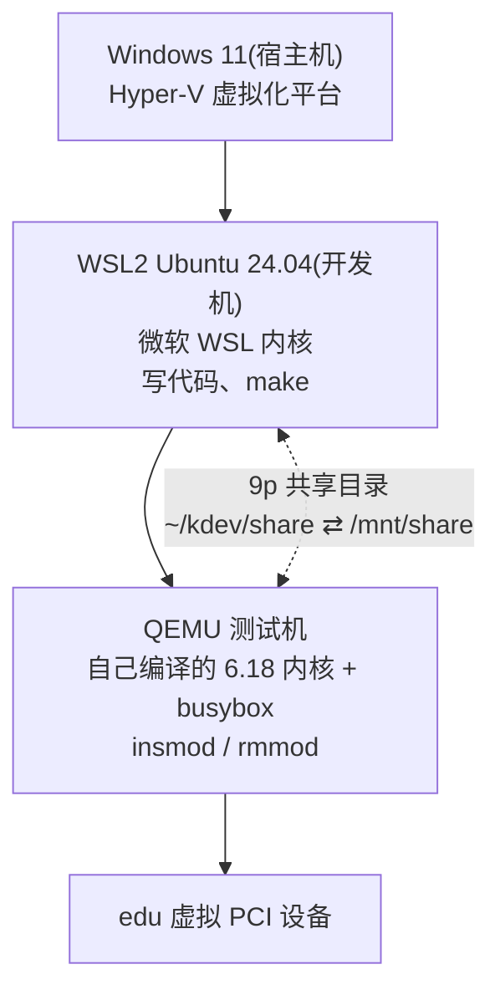

第一次用这套环境时最容易困惑的是:“我到底在哪台机器上?”这篇笔记把三层结构讲清楚。

## 三层机器



| 层 | 跑的内核 | 在这里做什么 | 提示符 |
|---|---|---|---|
| Windows | Windows | 进入 WSL:`wsl -d Ubuntu-24.04` | `PS C:\>` 或 Git Bash 的 `$` |
| 开发机 | 微软 WSL 内核 | 改代码、编译内核和模块 | `user@host:~$` |
| 测试机 | 自己编译的内核 | 加载驱动、测试、触发崩溃 | `/mnt/share #` |

一个常见误区:在 Git Bash 里输入 `~/kdev/scripts/run-qemu.sh` 会提示找不到文件,因为 Git Bash 里的 `~` 是 Windows 的用户目录 `C:\Users\<你>`,而 `~/kdev` 在 WSL 的文件系统里。要么先 `wsl` 进入 Ubuntu,要么在 Git Bash 里写成:

```bash
wsl -d Ubuntu-24.04 -- bash -c '~/kdev/scripts/run-qemu.sh'
```

单引号保证 `~` 到了 Ubuntu 里才展开。在 Windows 资源管理器里可以通过 `\\wsl.localhost\Ubuntu-24.04\home\<用户名>\kdev` 访问这些文件。

## 为什么不直接在开发机里加载驱动

- 开发机跑的是微软定制的 WSL 内核,没有现成的内核头文件,模块编不出来或者 vermagic 对不上。
- 驱动写崩了,整个 WSL(包括你的编辑器终端、编译进程)都会挂掉。
- 测试机里有我们需要的 edu 虚拟 PCI 设备,开发机里没有。

## KVM 是什么

**KVM**(Kernel-based Virtual Machine)是 Linux 内核自带的虚拟化模块。它让 Linux 能直接使用 CPU 的硬件虚拟化指令(AMD 叫 AMD-V/SVM,Intel 叫 VT-x),`/dev/kvm` 是它暴露给用户态程序的接口。

QEMU 和 KVM 的分工:

- **QEMU** 负责模拟“硬件”:磁盘、网卡、串口、edu 设备等。
- **KVM** 负责让虚拟机里的 CPU 指令直接在真实 CPU 上执行。

QEMU 加上 `-enable-kvm` 时,测试机几秒内就能启动;没有 KVM 时,QEMU 需要用软件(TCG)逐条翻译每条指令,速度慢几十倍。

## 嵌套虚拟化

这里其实是虚拟机里套虚拟机:Windows 的 Hyper-V 运行 WSL2 这台轻量虚拟机,WSL2 里又通过 KVM 运行 QEMU。这需要 Hyper-V 把硬件虚拟化能力“透传”给 WSL2,也就是嵌套虚拟化。Windows 11 上的 WSL2 默认开启了这个能力,所以在 WSL2 里能看到 `/dev/kvm`:

```bash
$ ls -l /dev/kvm
crw-rw---- 1 root kvm 10, 232 Nov 11 11:19 /dev/kvm
```

如果 `/dev/kvm` 不存在,QEMU 去掉 `-enable-kvm -cpu host` 也能跑,只是慢很多。

## 虚拟机的局限

虚拟机里碰不到真实的 GPU,所以没法调试真正的 amdgpu 驱动。学习驱动框架和开发流程时,edu 这类虚拟设备完全够用;要动真硬件,需要一台装 Linux 的实体机器。
