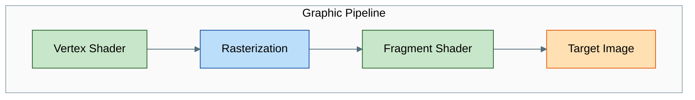
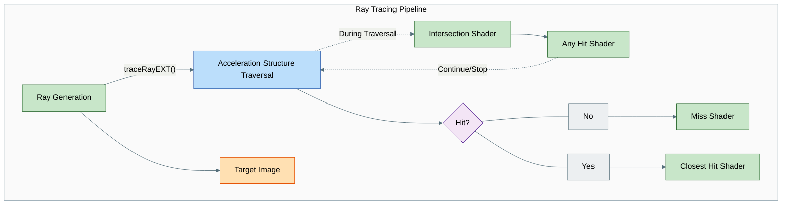
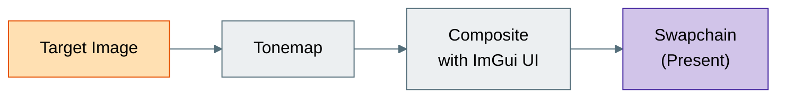

## 转换前:光栅化管线

> **译注**:下图中的标注保留英文原文。图意:在“图形管线(Graphic Pipeline)”中,顶点着色器(Vertex Shader,可编程)→ 光栅化(Rasterization,固定功能)→ 片元着色器(Fragment Shader,可编程)→ 目标图像(Target Image,输出)。

## 转换后:光线追踪管线

> **译注**:图意:在“光线追踪管线(Ray Tracing Pipeline)”中,光线生成着色器(Ray Generation)调用 `traceRayEXT()` 进入加速结构遍历(Acceleration Structure Traversal,固定功能/硬件阶段),并把结果写入目标图像(Target Image)。遍历过程中可能调用相交着色器(Intersection Shader),再调用任意命中着色器(Any Hit Shader),后者可以让遍历继续或停止。遍历结束后判断“是否命中(Hit?)”:否(No)则执行未命中着色器(Miss Shader),是(Yes)则执行最近命中着色器(Closest Hit Shader)。

**配色说明(与上面的光栅化示意图相同):**
🟢 可编程着色器 —— 🔵 固定功能 / 硬件阶段 —— 🟣 判断 —— 🟠 输出目标。

## 像素究竟去了哪里:目标图像

两条管线都不会直接写到屏幕上。它们都会填充同一张中间的 **目标图像(target image)**:

- **光栅化** 把它当作帧缓冲(framebuffer)的颜色附件(color attachment)来写入。
- **光线追踪** 通过存储图像(storage image)绑定来写入它(在光线生成着色器中是 `RWTexture2D`)。

随后,目标图像会经过色调映射(tonemap),再与 ImGui 的界面叠加层合成,最后提交(present)到交换链(swapchain)上显示。这就是为什么上面两张管线示意图最终都汇聚到同一个 `Target Image` 节点:选择哪种管线影响的是像素 *如何* 产生,而不是像素 *最终去往何处*。

> **译注**:图意:目标图像(Target Image)→ 色调映射(Tonemap)→ 与 ImGui 界面合成(Composite with ImGui UI)→ 交换链(Swapchain,Present 呈现)。

