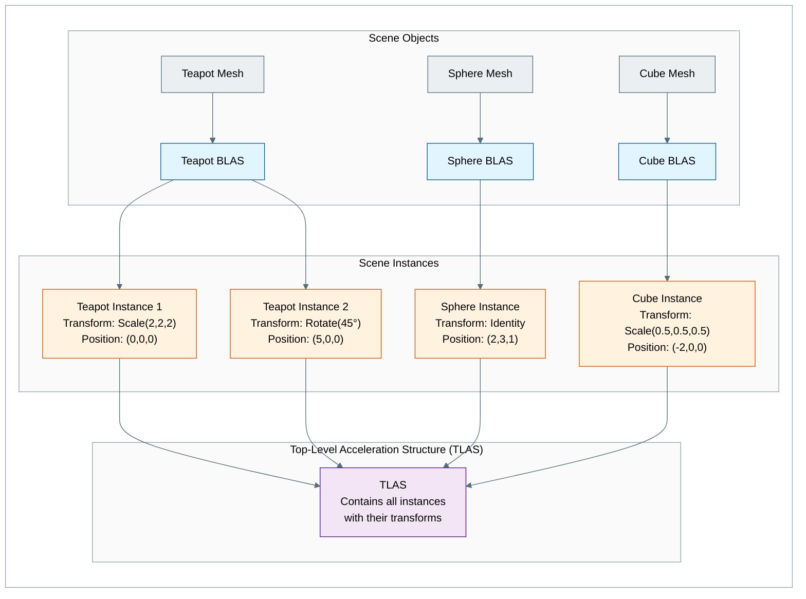

光线追踪需要高效的数据结构,以便快速判断一条光线可能与哪些几何体相交。Vulkan 使用两级的加速结构(acceleration structure)层次,把几何数据和场景组织分离开来。在动手实现光线追踪之前,理解这个概念至关重要。

## BLAS(底层加速结构,Bottom-Level Acceleration Structure)

**包含什么**:单个网格的实际几何数据(三角形、顶点、索引)。注意:法线、UV 和其他属性并不存储在 BLAS 里——它们在着色器中被单独访问。

**用途**:把三角形几何组织成一种空间数据结构(通常是包围体层次结构(BVH)),以便快速进行光线-三角形相交测试

**数量**:通常每个不同的网格对应一个 BLAS,但为了优化,也可以把多个网格合并到一个 BLAS 中。为简单起见,本教程每个网格使用一个 BLAS。

**示例**:一个茶壶网格拥有自己的 BLAS,其中包含茶壶的全部三角形,并以便于高效光线求交的方式组织起来

## TLAS(顶层加速结构,Top-Level Acceleration Structure)

**包含什么**:对 BLAS 结构的引用,以及它们在世界空间中的变换(位置、旋转、缩放)

**用途**:组织场景中的实例(instance),以便高效地进行光线与场景的相交测试

**数量**:整个场景一个 TLAS

**示例**:TLAS 中包含这样的实例:“位于 (1,0,1)、旋转 45°、缩放 2.0 的茶壶 BLAS”

## 为什么要分两级?

这种两级层次结构带来了几项关键的好处:

- **效率**:静态几何(BLAS)可以只构建一次,然后多次复用
- **灵活**:同一个网格可以在不同位置多次出现(实例化,instancing)
- **性能**:动态物体只需更新自己在 TLAS 中的条目,而不必重建代价高昂的 BLAS 结构
- **内存**:共享的几何只在 BLAS 中存储一份,在 TLAS 中被多次引用

## 光线追踪的过程

1. **光线生成**:光线从相机出发,穿过一个像素
2. **TLAS 求交**:光线与 TLAS 求交,找出可能被命中的实例
3. **BLAS 测试**:对每个潜在的命中,先对光线做变换,再与对应的 BLAS 进行测试
4. **确定命中**:最近的交点决定了命中点和材质

## 主要区别

| 方面 | BLAS | TLAS |
|--------|------|------|
| **数据类型** | 三角形几何、AABB | 实例引用 |
| **内容** | 顶点、索引、法线 | 变换矩阵、BLAS 引用 |
| **数量** | 每个网格/物体一个 | 每个场景一个 |
| **更新** | 很少(静态几何) | 频繁(动态物体) |
| **内存** | 大(几何数据) | 小(实例数据) |

> **译注**:上表“内容”一行列出了法线,但前文已说明法线等属性并不存放在 BLAS 中;这里照原文翻译,理解时以前文为准。

## 示意图

> **译注**:下图中的标注保留英文原文。图意(自下而上):在“场景物体(Scene Objects)”中,茶壶、球体、立方体网格(Mesh)各自生成一个 BLAS;在“场景实例(Scene Instances)”中,茶壶 BLAS 被两个实例引用(实例 1:缩放 (2,2,2)、位置 (0,0,0);实例 2:旋转 45°、位置 (5,0,0)),球体 BLAS 被一个实例引用(单位变换、位置 (2,3,1)),立方体 BLAS 被一个实例引用(缩放 (0.5,0.5,0.5)、位置 (-2,0,0));所有实例最终汇入顶层加速结构(TLAS),TLAS 包含全部实例及其变换。

