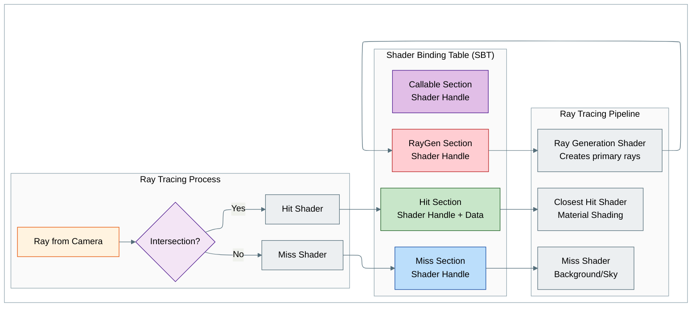

着色器绑定表(Shader Binding Table,SBT)是一份“蓝图”,它告诉光线追踪器:遇到不同类型的光线相交时应该执行哪些着色器。在光栅化中,着色器是按顺序依次绑定的;而在光线追踪中,光线随时可能命中任何表面,因此所有着色器必须同时可用。

## SBT 是什么?

SBT 是一个缓冲区,其中存放着 **着色器句柄(shader handle)**——一种不透明的标识符,用来告诉 GPU 要执行哪个着色器程序。它分为四个部分:

1. **光线生成着色器(Ray Generation Shaders)**:每个像素主光线(primary ray)的入口点
2. **未命中着色器(Miss Shaders)**:光线没有命中任何几何体时执行(背景/天空)
3. **命中着色器(Hit Shaders)**:光线与几何体相交时执行(材质着色)
4. **可调用着色器(Callable Shaders)**:可选的着色器,可以从其他着色器中调用

## 为什么需要 SBT?

在光线追踪中,一条光线可能命中场景中的任何物体,而不同物体可能需要不同的着色器(例如不同的材质、透明效果)。SBT 提供了一张查找表,用来建立以下映射:

- **光线类型** → **执行哪个着色器**
- **实例类型** → **使用哪个材质着色器**
- **未命中的情形** → **使用哪个背景着色器**

## SBT 的结构与流程

> **译注**:下图中的标注保留英文原文。图意:图中有三组。“光线追踪管线(Ray Tracing Pipeline)”组包含光线生成着色器(生成主光线)、未命中着色器(背景/天空)、最近命中着色器(材质着色);“着色器绑定表(SBT)”组包含 RayGen 区(着色器句柄)、Miss 区(着色器句柄)、Hit 区(着色器句柄 + 数据)、Callable 区(着色器句柄);“光线追踪过程(Ray Tracing Process)”组中,来自相机的光线进行相交判断,命中(Yes)则走命中着色器、未命中(No)则走未命中着色器。命中着色器查找 SBT 的 Hit 区,再由 Hit 区指向最近命中着色器;未命中着色器查找 Miss 区,再由 Miss 区指向管线中的未命中着色器;光线生成着色器与 RayGen 区互相对应。

## 关键概念

**着色器句柄(Shader Handles)**:不透明的标识符(通常为 32–64 字节),在管线中唯一标识一个已编译的着色器程序。

**SBT 区域(SBT Regions)**:每个部分(raygen、miss、hit、callable)都有自己的内存区域,并且有特定的对齐要求。

**实例关联(Instance Association)**:TLAS 中的实例可以通过 `hitGroupId` 字段指定使用哪个命中着色器。

> **译注**:在 Vulkan 的 `VkAccelerationStructureInstanceKHR` 结构中,对应的字段名是 `instanceShaderBindingTableRecordOffset`(见[阶段 2](/raytracing/03-nvidia-tutorial/06-phase2-as-infrastructure/)中的代码)。

**附加数据(Data Attachment)**:命中着色器可以在着色器句柄旁边附带自定义数据(材质属性、逐实例数据)。

## 简单示例

对于只有一种材质的基本场景:

- **RayGen 区**:包含光线生成着色器的句柄
- **Miss 区**:包含背景着色器(灰色/天空)的句柄
- **Hit 区**:包含材质着色器(PBR 着色)的句柄

当光线命中几何体时,光线追踪器从 SBT 中查找命中着色器的句柄,并执行对应的着色器程序。

## 教程结构

本教程分为 **8 个循序渐进的阶段**,每个阶段结束时程序都可以编译、可以测试:

### 阶段的结构

每个阶段包括:

- **阶段概览(Phase Overview)**:这一阶段要完成什么,以及预期结果
- **代码修改(Code Changes)**:具体涉及的文件和确切的代码改动
- **阶段检查点(Phase Checkpoint)**:在每个检查点你应该看到什么,以及预期结果
