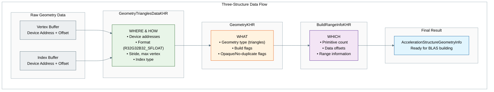

## 阶段概览

**阶段目标**:搭建创建加速结构(acceleration structure)所需的基础设施,但暂时还不真正构建它们。

- 编写几何转换辅助方法
- 编写通用的加速结构辅助函数
- 搭建基本的 BLAS 创建框架(不进行构建)
- 为下一阶段创建加速结构做好准备

**预期结果**:创建加速结构的基础设施已经就绪,但还没有构建任何加速结构。应用程序仍然使用光栅化。

## 代码修改

### 步骤 2.1:编写几何转换辅助函数

添加下面这个辅助方法,把网格数据转换成加速结构所需的几何描述。

```cpp
void primitiveToGeometry(const shaderio::GltfMesh&                 gltfMesh,
                         VkAccelerationStructureGeometryKHR&       geometry,
                         VkAccelerationStructureBuildRangeInfoKHR& rangeInfo)
{
    const shaderio::TriangleMesh triMesh       = gltfMesh.triMesh;
    const auto                   triangleCount = static_cast<uint32_t>(triMesh.indices.count / 3U);

    // Describe buffer as array of VertexObj.
    VkAccelerationStructureGeometryTrianglesDataKHR triangles{
        .sType        = VK_STRUCTURE_TYPE_ACCELERATION_STRUCTURE_GEOMETRY_TRIANGLES_DATA_KHR,
        .vertexFormat = VK_FORMAT_R32G32B32_SFLOAT,  // vec3 vertex position data
        .vertexData   = {.deviceAddress = VkDeviceAddress(gltfMesh.gltfBuffer) + triMesh.positions.offset},
        .vertexStride = triMesh.positions.byteStride,
        .maxVertex    = triMesh.positions.count - 1,
        .indexType    = VkIndexType(gltfMesh.indexType),  // Index type (VK_INDEX_TYPE_UINT16 or VK_INDEX_TYPE_UINT32)
        .indexData    = {.deviceAddress = VkDeviceAddress(gltfMesh.gltfBuffer) + triMesh.indices.offset},
    };

    // Identify the above data as containing opaque triangles.
    geometry = VkAccelerationStructureGeometryKHR{
        .sType        = VK_STRUCTURE_TYPE_ACCELERATION_STRUCTURE_GEOMETRY_KHR,
        .geometryType = VK_GEOMETRY_TYPE_TRIANGLES_KHR,
        .geometry     = {.triangles = triangles},
        .flags        = VK_GEOMETRY_NO_DUPLICATE_ANY_HIT_INVOCATION_BIT_KHR | VK_GEOMETRY_OPAQUE_BIT_KHR,
    };

    rangeInfo = VkAccelerationStructureBuildRangeInfoKHR{.primitiveCount = triangleCount};
}
```

> **注意**:`shaderio::GltfMesh` 是一种几何表示,具体形式可能因你的应用程序而异。在本例中,它遵循 glTF 格式:`gltfBuffer` 指向二进制数据(`.bin`),偏移量(offset)和步长(stride)则来自属性访问器(accessor)和缓冲区视图(buffer view)。

> **注意**:`shaderio::GltfMesh` 的数据已经上传到 GPU 缓冲区,因此着色器可以像主机端(host)一样直接访问它。

### 理解“三个结构体”的数据流

创建加速结构时,Vulkan 使用三个协同工作的关键结构体:

> **译注**:下图中的标注保留英文原文。图意:原始几何数据(顶点缓冲区、索引缓冲区,均为“设备地址 + 偏移”)→ `GeometryTrianglesDataKHR`(WHERE & HOW:设备地址、格式 R32G32B32_SFLOAT、步长与最大顶点、索引类型)→ `GeometryKHR`(WHAT:几何类型为三角形、构建标志、不透明/不重复调用标志)→ `BuildRangeInfoKHR`(WHICH:图元数量、数据偏移、范围信息)→ 最终结果:可用于构建 BLAS 的加速结构几何信息。



**1. VkAccelerationStructureGeometryTrianglesDataKHR:**

- 定义从 **哪里(WHERE)** 读取顶点/索引数据(设备地址),以及 **如何(HOW)** 解释这些数据(格式、步长等)

**2. VkAccelerationStructureGeometryKHR:**

- 一层包装,指定几何体是 **什么(WHAT)** 类型(三角形、实例、AABB)以及构建标志

**3. VkAccelerationStructureBuildRangeInfoKHR:**

- 定义处理数据中的 **哪一部分(WHICH)**(图元数量、偏移量等)

### 几何类型

Vulkan 光线追踪支持三种主要的几何类型:

**三角形(`VK_GEOMETRY_TYPE_TRIANGLES_KHR`):**

- 传统的网格几何,带有顶点和索引数据
- 标准 3D 模型最常用的类型
- 硬件针对三角形求交做了优化

**实例(`VK_GEOMETRY_TYPE_INSTANCES_KHR`):**

- 对其他加速结构的引用
- 在 TLAS 中用来引用 BLAS 结构
- 让场景的组合更加高效

**AABB(`VK_GEOMETRY_TYPE_AABBS_KHR`):**

- 用于隐式图元的轴对齐包围盒(Axis-Aligned Bounding Box,AABB)
- 与相交着色器(intersection shader)配合,用于程序化几何体
- 无需显式的三角形网格就能渲染数学形状(球体、立方体等)

---

**NVIDIA 扩展的几何类型** *(VK_NV_ray_tracing 系列扩展)*

NVIDIA 在标准的 Vulkan 光线追踪几何类型之外,又扩展了两种类型,它们 **只在最新的 NVIDIA RTX GPU(Blackwell/RTX 50 系列或更新)上可用**:

**球体(`VK_GEOMETRY_TYPE_SPHERES_NV`):**

- 原生支持完美球体,无需曲面细分
- 几何数据:存放球体参数(球心、半径)的缓冲区
- 硬件加速的相交测试
- 需要相交着色器来实现自定义的命中逻辑

**线性扫掠球体(`VK_GEOMETRY_TYPE_LINEAR_SWEPT_SPHERES_NV`):**

- 沿直线路径扫掠的球体(胶囊体)
- 几何数据:存放扫掠球体参数(球心、半径、速度/方向)的缓冲区
- 高效地表示胶囊体和带运动模糊的球体

### 步骤 2.2:编写通用的加速结构辅助函数

添加下面这个通用的辅助方法,它既能创建 BLAS,也能创建 TLAS。这个方法处理了 Vulkan 创建加速结构的通用流程:

```cpp
// Generic function to create an acceleration structure (BLAS or TLAS)
// Note: This function creates and destroys a scratch buffer for each call.
// Not optimal but easier to read and understand. See Helper function for a better approach.
void createAccelerationStructure(VkAccelerationStructureTypeKHR asType,  // The type of acceleration structure (BLAS or TLAS)
                                 nvvk::AccelerationStructure& accelStruct,  // The acceleration structure to create
                                 VkAccelerationStructureGeometryKHR& asGeometry,  // The geometry to build the acceleration structure from
                                 VkAccelerationStructureBuildRangeInfoKHR& asBuildRangeInfo,  // The range info for building the acceleration structure
                                 VkBuildAccelerationStructureFlagsKHR flags  // Build flags (e.g. prefer fast trace)
)
{
    VkDevice device = m_app->getDevice();

    // Helper function to align a value to a given alignment
    auto alignUp = [](auto value, size_t alignment) noexcept { return ((value + alignment - 1) & ~(alignment - 1)); };

    // Fill the build information with the current information, the rest is filled later (scratch buffer and destination AS)
    VkAccelerationStructureBuildGeometryInfoKHR asBuildInfo{
        .sType         = VK_STRUCTURE_TYPE_ACCELERATION_STRUCTURE_BUILD_GEOMETRY_INFO_KHR,
        .type          = asType,  // The type of acceleration structure (BLAS or TLAS)
        .flags         = flags,   // Build flags (e.g. prefer fast trace)
        .mode          = VK_BUILD_ACCELERATION_STRUCTURE_MODE_BUILD_KHR,  // Build mode vs update
        .geometryCount = 1,                                               // Deal with one geometry at a time
        .pGeometries   = &asGeometry,  // The geometry to build the acceleration structure from
    };

    // One geometry at a time (could be multiple)
    std::vector<uint32_t> maxPrimCount(1);
    maxPrimCount[0] = asBuildRangeInfo.primitiveCount;

    // Find the size of the acceleration structure and the scratch buffer
    VkAccelerationStructureBuildSizesInfoKHR asBuildSize{.sType = VK_STRUCTURE_TYPE_ACCELERATION_STRUCTURE_BUILD_SIZES_INFO_KHR};
    vkGetAccelerationStructureBuildSizesKHR(device, VK_ACCELERATION_STRUCTURE_BUILD_TYPE_DEVICE_KHR, &asBuildInfo,
                                            maxPrimCount.data(), &asBuildSize);

    // Make sure the scratch buffer is properly aligned
    VkDeviceSize scratchSize = alignUp(asBuildSize.buildScratchSize, m_asProperties.minAccelerationStructureScratchOffsetAlignment);

    // Create the scratch buffer to store the temporary data for the build
    nvvk::Buffer scratchBuffer;
    NVVK_CHECK(m_allocator.createBuffer(scratchBuffer, scratchSize,
                                        VK_BUFFER_USAGE_2_STORAGE_BUFFER_BIT | VK_BUFFER_USAGE_2_SHADER_DEVICE_ADDRESS_BIT
                                            | VK_BUFFER_USAGE_2_ACCELERATION_STRUCTURE_STORAGE_BIT_KHR, VMA_MEMORY_USAGE_AUTO, {}, m_asProperties.minAccelerationStructureScratchOffsetAlignment));

    // Create the acceleration structure
    VkAccelerationStructureCreateInfoKHR createInfo{
        .sType = VK_STRUCTURE_TYPE_ACCELERATION_STRUCTURE_CREATE_INFO_KHR,
        .size  = asBuildSize.accelerationStructureSize,  // The size of the acceleration structure
        .type  = asType,  // The type of acceleration structure (BLAS or TLAS)
    };
    NVVK_CHECK(m_allocator.createAcceleration(accelStruct, createInfo));

    // Build the acceleration structure
    {
      VkCommandBuffer cmd = m_app->createTempCmdBuffer();

      // Fill with new information for the build,scratch buffer and destination AS
      asBuildInfo.dstAccelerationStructure  = accelStruct.accel;
      asBuildInfo.scratchData.deviceAddress = scratchBuffer.address;

      VkAccelerationStructureBuildRangeInfoKHR* pBuildRangeInfo = &asBuildRangeInfo;
      vkCmdBuildAccelerationStructuresKHR(cmd, 1, &asBuildInfo, &pBuildRangeInfo);

      m_app->submitAndWaitTempCmdBuffer(cmd);
    }
    // Cleanup the scratch buffer
    m_allocator.destroyBuffer(scratchBuffer);
}
```

> **注意**:这个辅助函数封装了 Vulkan 创建加速结构的完整过程。它负责内存对齐、创建暂存缓冲区(scratch buffer)以及实际的构建命令。暂存缓冲区是临时的,构建完成后就会被销毁。

### 理解 `createAccelerationStructure` 辅助函数

`createAccelerationStructure` 是一个通用的辅助函数,负责 Vulkan 创建加速结构的完整过程。下面逐步说明它做了什么:

#### 1. 设置构建信息

- 用几何数据创建一个 `VkAccelerationStructureBuildGeometryInfoKHR` 结构体
- 设置加速结构的类型(BLAS 或 TLAS)、构建标志和构建模式

#### 2. 计算大小

- 调用 `vkGetAccelerationStructureBuildSizesKHR` 来确定:
  - 加速结构本身所需的大小
  - 暂存缓冲区(临时工作内存)所需的大小
  - 更新用暂存缓冲区所需的大小(供以后更新时使用)

#### 3. 内存对齐

- 使用 `minAccelerationStructureScratchOffsetAlignment` 对暂存缓冲区的大小进行对齐,以满足硬件要求
- 这样可以确保暂存缓冲区的地址对 GPU 来说是正确对齐的

#### 4. 创建暂存缓冲区

- 按所需的大小和用途标志(usage flag)创建一个临时缓冲区:
  - `VK_BUFFER_USAGE_2_STORAGE_BUFFER_BIT` —— 可以用作存储缓冲区(storage buffer)
  - `VK_BUFFER_USAGE_2_SHADER_DEVICE_ADDRESS_BIT` —— 拥有设备地址(device address)
  - `VK_BUFFER_USAGE_2_ACCELERATION_STRUCTURE_STORAGE_BIT_KHR` —— 可以存储加速结构数据,并强制内存分配满足对齐要求。

#### 5. 创建加速结构

- 使用 `VkAccelerationStructureCreateInfoKHR` 创建实际的加速结构
- 其大小由第 2 步计算出的构建大小决定

#### 6. 构建过程

- 使用 `vkCmdBuildAccelerationStructuresKHR` 录制构建命令
- 该命令在构建过程中使用暂存缓冲区作为临时存储
- 提交命令并等待其执行完成

#### 7. 清理

- 销毁临时的暂存缓冲区,因为已经不再需要它

这种做法简单直接,但在性能上并不是最优的。在正式的生产环境应用中,你可能希望:

- 在多个加速结构之间复用暂存缓冲区
- 在同一个命令缓冲区(command buffer)中构建多个加速结构
- 对动态场景使用更新(update)模式,而不是从头重建

注意:[加速结构辅助工具](/rt-docs/04-nvidia-concepts/01-acceleration-structures/)会处理上述所有事情,而且做得更多。不过为了保持简单,这里我们使用一种直截了当的方法。

### 步骤 2.3:编写 BLAS 创建方法(仅搭建框架)

添加下面这个方法,为底层加速结构(BLAS)的创建搭好框架。目前它只准备几何数据,并不进行构建:

```cpp
void createBottomLevelAS()
{
    SCOPED_TIMER(__FUNCTION__);
    
    // Prepare geometry information for all meshes
    m_blasAccel.resize(m_sceneResource.meshes.size());
    
    // For now, just log that we're ready to build BLAS
    LOGI("  Ready to build %zu bottom-level acceleration structures\n", m_sceneResource.meshes.size());
    
    // TODO: In Phase 3, we'll add the actual building:
    // For each mesh 
    //   - create acceleration structure geometry from internal mesh primitive (primitiveToGeometry)
    //   - create acceleration structure
}
```

### 步骤 2.4:编写 TLAS 创建方法(仅搭建框架)

添加下面这个方法,为顶层加速结构(TLAS)的创建搭好框架:

```cpp
void createTopLevelAS()
{
    SCOPED_TIMER(__FUNCTION__);

    // VkTransformMatrixKHR is row-major 3x4, glm::mat4 is column-major; transpose before memcpy.
    auto toTransformMatrixKHR = [](const glm::mat4& m) {
      VkTransformMatrixKHR t;
      memcpy(&t, glm::value_ptr(glm::transpose(m)), sizeof(t));
      return t;
    };

    // Prepare instance data for TLAS
    std::vector<VkAccelerationStructureInstanceKHR> tlasInstances;
    tlasInstances.reserve(m_sceneResource.instances.size());
    
    for(const shaderio::GltfInstance& instance : m_sceneResource.instances)
    {
        VkAccelerationStructureInstanceKHR asInstance{};
        asInstance.transform                      = toTransformMatrixKHR(instance.transform);  // Position of the instance
        asInstance.instanceCustomIndex            = instance.meshIndex;                       // gl_InstanceCustomIndexEXT
        // asInstance.accelerationStructureReference = m_blasAccel[instance.meshIndex].address;  // Will be set in Phase 3
        asInstance.instanceShaderBindingTableRecordOffset = 0;  // We will use the same hit group for all objects
        asInstance.flags = VK_GEOMETRY_INSTANCE_TRIANGLE_CULL_DISABLE_BIT_NV;  // No culling - double sided
        asInstance.mask  = 0xFF;
        tlasInstances.emplace_back(asInstance);
    }
    
    // For now, just log that we're ready to build TLAS
    LOGI("  Ready to build top-level acceleration structure with %zu instances\n", tlasInstances.size());
    
    // TODO: In Phase 3, we'll add the actual building:
    // 1. Create and upload instance buffer
    // 2. Create TLAS geometry from instances
    // 3. Call createAccelerationStructure with TLAS type
}
```

我们正在为加速结构做准备。对于底层加速结构,几何体的顶点和索引数据已经在 GPU 上了;对于实例,我们也需要做同样的事情。这里我们只是准备好实例数组,稍后再把它上传到 GPU。

### 步骤 2.5:调用基础设施的设置函数

在 `onAttach()` 方法的末尾,添加调用来搭建这些基础设施:

```cpp
// Set up acceleration structure infrastructure
createBottomLevelAS();  // Set up BLAS infrastructure
createTopLevelAS();     // Set up TLAS infrastructure
```

## 阶段 2 检查点

**此时,你的应用程序应该:**

✅ **编译成功**,没有错误或警告  
✅ **运行时不崩溃**,并显示与之前相同的光栅化场景  
✅ **在控制台输出中显示基础设施设置的消息**  
✅ **几何转换方法已经就绪**,可用于创建加速结构  

**需要验证的内容:**

- 控制台输出中有类似 “Ready to build X bottom-level acceleration structures” 的消息
- 控制台输出中有 “Ready to build top-level acceleration structure with X instances”
- 应用程序的画面与阶段 1 完全相同(仍在使用光栅化)
- 没有内存泄漏或验证错误

**预期的控制台输出:**

```bash
Ready to build 2 bottom-level acceleration structures
Ready to build top-level acceleration structure with 2 instances
```

## 下一步

在[阶段 3](/rt-docs/03-nvidia-tutorial/07-phase3-basic-as/)中,我们将利用刚刚搭好的基础设施真正构建加速结构。这一步会创建光线追踪所需的 BLAS 和 TLAS,以便高效地遍历几何体。
