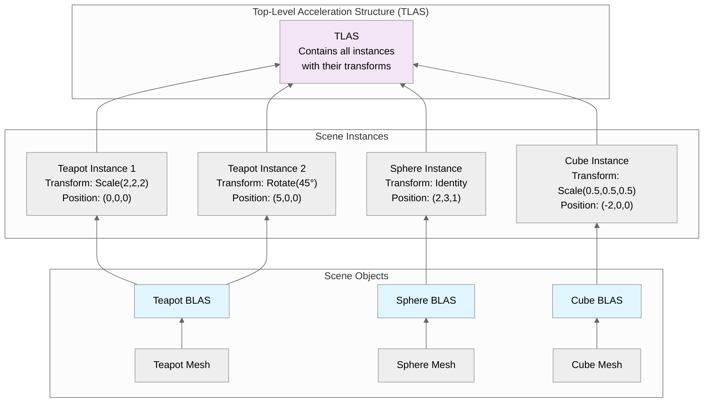
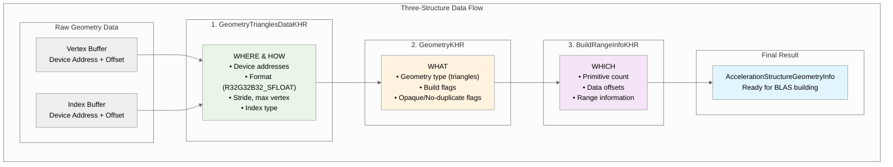
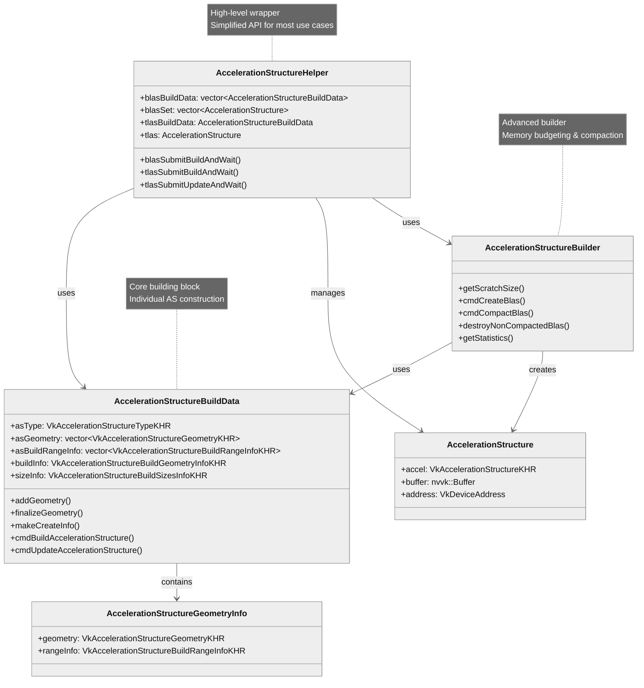
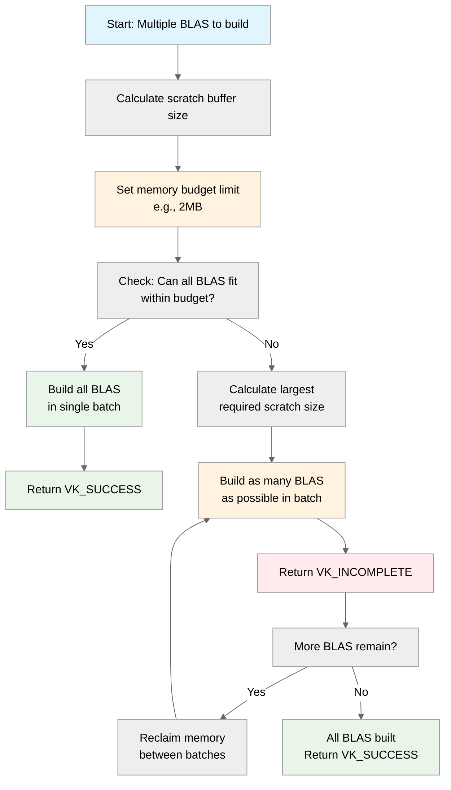
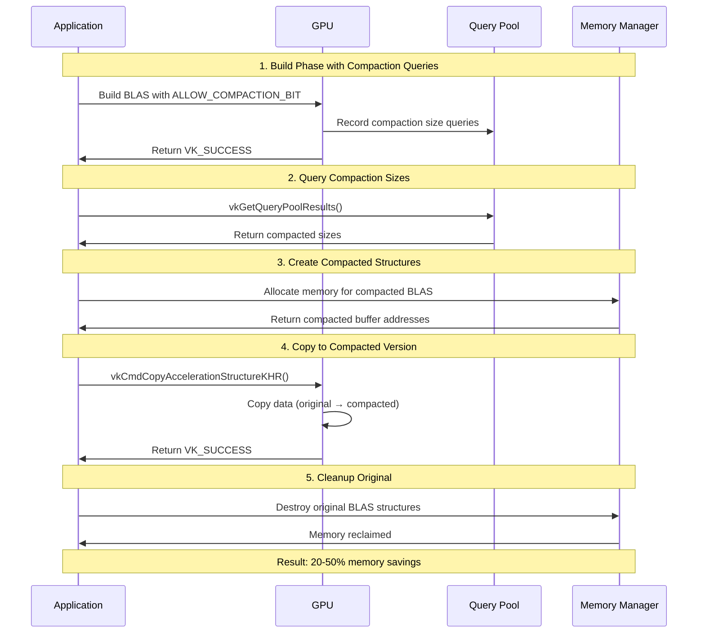

## 概述

Vulkan 光线追踪中的加速结构(acceleration structure)是一种层次化的数据结构,它把几何体组织起来,让光线相交查询能够高效完成。通过减少渲染时需要做的光线-三角形相交测试次数,加速结构成为光线追踪应用达到实时性能的关键。

**性能上的好处:**

- **减少相交测试**:几何体按层次组织后,光线追踪可以直接跳过场景中光线根本不可能相交的大片区域
- **硬件加速**:现代 GPU 用专用硬件实现这些结构,以获得最佳性能
- **可扩展的渲染**:性能随场景复杂度呈对数增长,而不是线性增长

## 快速入门

只需 5 步就能创建加速结构:

```cpp
// 1. Prepare geometry data
std::vector<nvvk::AccelerationStructureGeometryInfo> geoInfos;
for(const auto& mesh : meshes) {
    geoInfos.push_back(primitiveToGeometry(mesh));
}

// 2. Initialize the helper
nvvk::AccelerationStructureHelper asBuilder{};
asBuilder.init(&allocator, &stagingUploader, queue);

// 3. Build BLAS structures
asBuilder.blasSubmitBuildAndWait(geoInfos, 
    VK_BUILD_ACCELERATION_STRUCTURE_PREFER_FAST_TRACE_BIT_KHR);

// 4. Create TLAS instances
std::vector<VkAccelerationStructureInstanceKHR> tlasInstances;
for(const auto& instance : instances) {
    VkAccelerationStructureInstanceKHR ray_inst{};
    ray_inst.transform = nvvk::toTransformMatrixKHR(instance.transform);
    ray_inst.instanceCustomIndex = instance.meshIndex;
    ray_inst.accelerationStructureReference = asBuilder.blasSet[instance.meshIndex].address;
    ray_inst.mask = 0xFF;
    tlasInstances.push_back(ray_inst);
}

// 5. Build TLAS
asBuilder.tlasSubmitBuildAndWait(tlasInstances, 
    VK_BUILD_ACCELERATION_STRUCTURE_PREFER_FAST_TRACE_BIT_KHR);
```

**这段代码做了什么:**

- **第 1 步**:把网格数据转换成加速结构所需的几何体描述
- **第 2 步**:设置辅助类,简化创建过程
- **第 3 步**:为几何体构建底层加速结构(BLAS)
- **第 4 步**:创建带变换的实例(instance),用来组成场景
- **第 5 步**:为整个场景构建顶层加速结构(TLAS)

**前提条件:**

- 包含顶点和索引的网格数据
- 用于摆放物体的实例变换
- 资源分配器和命令队列

这套最精简的设置已经处理了所有复杂的内存管理、对齐和 Vulkan API 调用。下面各节会给出详细解释和高级功能。

## 加速结构的类型

### BLAS 与 TLAS 的关系

下图展示了在一个典型场景中 BLAS 和 TLAS 是如何协同工作的:



图意:茶壶、球体、立方体三个网格(Mesh)各自构建一个 BLAS;茶壶 BLAS 被两个实例引用(一个放大 2 倍、位于原点,一个旋转 45° 、位于 (5,0,0)),球体和立方体各有一个实例;所有实例连同各自的变换一起放进同一个 TLAS。

### 底层加速结构(BLAS)

BLAS 包含实际的几何图元(三角形),由以下内容构建:

- **顶点数据**:顶点的三维位置
- **索引数据**:三角形索引
- **构建标志**:优化提示(例如 `VK_BUILD_ACCELERATION_STRUCTURE_PREFER_FAST_TRACE_BIT_KHR`)

**关键特性:**

- BLAS 存储实际的顶点数据
- BLAS 由一个或多个顶点缓冲区构建,每个顶点缓冲区都有自己的变换矩阵(与 TLAS 中的矩阵相互独立)
- 一个 BLAS 中可以存放多个摆放好位置的模型
- 如果同一个物体在同一个 BLAS 内被实例化多次,它的几何数据会被复制多份
- 经验法则:对于静态、未实例化的场景部分,BLAS 越少,性能越好

### 顶层加速结构(TLAS)

TLAS 包含若干 BLAS 的实例,提供:

- **实例引用**:指向 BLAS 的指针
- **变换矩阵**:实例的位置、旋转和缩放(3×4 变换矩阵)
- **实例元数据**:自定义索引、着色器绑定表(SBT)偏移
- **剔除信息**:可见性掩码和标志

**关键特性:**

- 包含物体实例,每个实例都有自己的变换矩阵,以及对相应 BLAS 的引用
- 通常对应整个场景,通过摆放各个被引用的 BLAS 构成
- 当只有实例变换发生变化时,可以高效地更新

## 实际实现细节

上面的快速入门已经展示了完整流程。下面介绍每一步的关键实现细节和注意事项。

### 把网格数据转换为加速结构几何体

`primitiveToGeometry` 函数(来自 `02_basic.cpp`)把网格数据转换为 Vulkan 加速结构的格式。关键部分如下:

```cpp
nvvk::AccelerationStructureGeometryInfo primitiveToGeometry(const nvsamples::GltfMeshResource& gltfMesh)
{
    nvvk::AccelerationStructureGeometryInfo result = {};

    const shaderio::TriangleMesh triMesh       = gltfMesh.mesh.triMesh;
    const auto                   triangleCount = static_cast<uint32_t>(triMesh.indices.count / 3U);

    // Describe buffer as array of VertexObj.
    VkAccelerationStructureGeometryTrianglesDataKHR triangles{
        .sType        = VK_STRUCTURE_TYPE_ACCELERATION_STRUCTURE_GEOMETRY_TRIANGLES_DATA_KHR,
        .vertexFormat = VK_FORMAT_R32G32B32_SFLOAT,  // vec3 vertex position data
        .vertexData   = {.deviceAddress = gltfMesh.bGltfData.address + triMesh.positions.offset},
        .vertexStride = triMesh.positions.byteStride,
        .maxVertex    = triMesh.positions.count - 1,
        .indexType = VkIndexType(gltfMesh.mesh.indexType),  // Index type (VK_INDEX_TYPE_UINT16 or VK_INDEX_TYPE_UINT32)
        .indexData = {.deviceAddress = gltfMesh.bGltfData.address + triMesh.indices.offset},
    };

    // Identify the above data as containing opaque triangles.
    result.geometry = VkAccelerationStructureGeometryKHR{
        .sType        = VK_STRUCTURE_TYPE_ACCELERATION_STRUCTURE_GEOMETRY_KHR,
        .geometryType = VK_GEOMETRY_TYPE_TRIANGLES_KHR,
        .geometry     = {.triangles = triangles},
        .flags        = VK_GEOMETRY_NO_DUPLICATE_ANY_HIT_INVOCATION_BIT_KHR | VK_GEOMETRY_OPAQUE_BIT_KHR,
    };

    result.rangeInfo = VkAccelerationStructureBuildRangeInfoKHR{.primitiveCount = triangleCount};

    return result;
}
```

**重要注意事项:**

- **设备地址**:用 `gltfMesh.bGltfData.address + offset` 得到顶点/索引数据的设备地址
- **几何体标志**:
  - `VK_GEOMETRY_OPAQUE_BIT_KHR`:为不透明几何体启用光线追踪优化
  - `VK_GEOMETRY_NO_DUPLICATE_ANY_HIT_INVOCATION_BIT_KHR`:防止着色器被重复调用
- **图元数量**:按 `indices.count / 3` 计算,因为每个三角形使用 3 个索引

#### 理解三个结构体的数据流

创建加速结构时,Vulkan 使用三个相互配合的关键结构体:



图意:原始的顶点缓冲区和索引缓冲区(设备地址 + 偏移)先填入 `GeometryTrianglesDataKHR`(“在哪里、怎么读”),再包进 `GeometryKHR`(“是什么”),然后配上 `BuildRangeInfoKHR`(“处理哪一部分”),最终得到可用于构建 BLAS 的 `AccelerationStructureGeometryInfo`。

**1. VkAccelerationStructureGeometryTrianglesDataKHR:**

- 定义从**哪里**(WHERE)读取顶点/索引数据(设备地址),以及**如何**(HOW)解释这些数据(格式、步长等)

**2. VkAccelerationStructureGeometryKHR:**

- 一层包装,指定几何体是**什么**(WHAT)类型(三角形、实例、AABB)以及构建标志

**3. VkAccelerationStructureBuildRangeInfoKHR:**

- 定义要处理数据的**哪一部分**(WHICH)(图元数量、偏移等)

#### 几何体类型

Vulkan 光线追踪支持三种主要的几何体类型:

**三角形(`VK_GEOMETRY_TYPE_TRIANGLES_KHR`):**

- 传统的网格几何体,带有顶点和索引数据
- 标准三维模型最常用的类型
- 硬件针对三角形相交做了优化

**实例(`VK_GEOMETRY_TYPE_INSTANCES_KHR`):**

- 对其他加速结构的引用
- 在 TLAS 中用来引用 BLAS
- 让场景组合变得高效

**AABB(`VK_GEOMETRY_TYPE_AABBS_KHR`):**

- 轴对齐包围盒(Axis-Aligned Bounding Box),用于隐式图元
- 与相交着色器(intersection)配合,用于程序化几何体
- 无需显式的三角形网格,就能渲染数学形状(球体、立方体等)

---

**NVIDIA 扩展的几何体类型** *(VK_NV_ray_tracing 扩展)*

NVIDIA 在标准 Vulkan 光线追踪几何体类型之外又扩展了两种类型,它们**只在最新的 NVIDIA RTX GPU(Blackwell/RTX 50 系列或更新)上可用**:

**球体(`VK_GEOMETRY_TYPE_SPHERES_NV`):**

- 原生支持完美球体,无需细分成三角形
- 几何数据:存放球体参数(球心、半径)的缓冲区
- 硬件加速的相交测试
- 需要相交着色器来实现自定义的命中逻辑

**线性扫掠球体(`VK_GEOMETRY_TYPE_LINEAR_SWEPT_SPHERES_NV`):**

- 沿一条直线路径扫过的球体(胶囊体)
- 几何数据:存放扫掠球体参数(球心、半径、速度/方向)的缓冲区
- 能高效表示胶囊体和带运动模糊的球体

### 创建底层加速结构

下面是 `02_basic.cpp` 中的 `createBottomLevelAS` 函数。它借助高层辅助类,一次调用就创建出所有底层加速结构。`AccelerationStructureHelper::blasSubmitBuildAndWait()` 方法在内部处理了全部复杂性,包括命令缓冲区的创建、内存分配、正确的同步、**内存预算**,以及在设置了 `VK_BUILD_ACCELERATION_STRUCTURE_ALLOW_COMPACTION_BIT_KHR` 标志时的**自动压缩(compaction)**。

```cpp
void createBottomLevelAS()
{
    SCOPED_TIMER(__FUNCTION__);
    std::vector<nvvk::AccelerationStructureGeometryInfo> geoInfos(m_meshes.size());
    
    // Prepare geometry for each mesh
    for(uint32_t p_idx = 0; p_idx < m_meshes.size(); p_idx++)
    {
        geoInfos[p_idx] = primitiveToGeometry(m_meshes[p_idx]);
    }
    
    // Build all BLAS structures using the helper
    m_asBuilder.blasSubmitBuildAndWait(geoInfos, 
        VK_BUILD_ACCELERATION_STRUCTURE_PREFER_FAST_TRACE_BIT_KHR);
}
```

**要点:**

- **收集几何体**:为场景中的每个网格创建几何体信息
- **使用辅助类**:用 `AccelerationStructureHelper::blasSubmitBuildAndWait()` 简化 BLAS 的创建
- **构建标志**:使用 `VK_BUILD_ACCELERATION_STRUCTURE_PREFER_FAST_TRACE_BIT_KHR` 以获得最佳光线追踪性能。再加上 `VK_BUILD_ACCELERATION_STRUCTURE_ALLOW_COMPACTION_BIT_KHR` 可以减少内存占用。

### 创建顶层加速结构

下面是 `02_basic.cpp` 中的 `createTopLevelAS` 函数:

```cpp
void createTopLevelAS()
{
    std::vector<VkAccelerationStructureInstanceKHR> tlasInstances;
    tlasInstances.reserve(m_instances.size());
    const VkGeometryInstanceFlagsKHR flags{VK_GEOMETRY_INSTANCE_TRIANGLE_CULL_DISABLE_BIT_NV};
    
    for(const shaderio::GltfInstance& instance : m_instances)
    {
        VkAccelerationStructureInstanceKHR ray_inst{};
        ray_inst.transform           = nvvk::toTransformMatrixKHR(instance.transform);  // Position of the instance
        ray_inst.instanceCustomIndex = instance.meshIndex;                              // gl_InstanceCustomIndexEXT or InstanceID() (Slang)
        ray_inst.accelerationStructureReference = m_asBuilder.blasSet[instance.meshIndex].address;
        ray_inst.instanceShaderBindingTableRecordOffset = 0;  // We will use the same hit group for all objects
        ray_inst.flags                                  = flags;
        ray_inst.mask                                   = 0xFF;
        tlasInstances.emplace_back(ray_inst);
    }

    m_asBuilder.tlasSubmitBuildAndWait(tlasInstances, 
        VK_BUILD_ACCELERATION_STRUCTURE_PREFER_FAST_TRACE_BIT_KHR);
}
```

**要点:**

- **创建实例**:为每个网格创建带变换矩阵的实例
- **变换转换**:用 `nvvk::toTransformMatrixKHR()` 把 `glm::mat4` 转换成 Vulkan 的格式
- **引用 BLAS**:通过 `accelerationStructureReference` 把每个实例链接到对应的 BLAS
- **实例元数据**:设置自定义索引、SBT 偏移和可见性掩码

## 辅助类的架构

### 类层次概览

下图展示了各个辅助类之间的关系及其职责:



图意:`AccelerationStructureHelper` 是高层包装(适合大多数场合的简化 API),它使用 `AccelerationStructureBuildData` 和 `AccelerationStructureBuilder`,并管理 `AccelerationStructure`;`AccelerationStructureBuilder` 是高级构建器(负责内存预算与压缩),使用 `AccelerationStructureBuildData` 并创建 `AccelerationStructure`;`AccelerationStructureBuildData` 是核心构建单元(负责单个加速结构的构建),其中包含 `AccelerationStructureGeometryInfo`。

### AccelerationStructureHelper(高层包装)

这是在 `02_basic.cpp` 这类基础教程中使用的**简化接口**:

```cpp
class AccelerationStructureHelper
{
public:
    // BLAS management
    std::vector<AccelerationStructureBuildData> blasBuildData;
    std::vector<AccelerationStructure> blasSet;
    
    // TLAS management
    AccelerationStructureBuildData tlasBuildData;
    AccelerationStructure tlas;
    
    // High-level build methods - these handle everything internally
    void blasSubmitBuildAndWait(const std::vector<AccelerationStructureGeometryInfo>& asGeoInfoSet,
                                VkBuildAccelerationStructureFlagsKHR buildFlags);
    void tlasSubmitBuildAndWait(const std::vector<VkAccelerationStructureInstanceKHR>& tlasInstances,
                                VkBuildAccelerationStructureFlagsKHR buildFlags);
    void tlasSubmitUpdateAndWait(const std::vector<VkAccelerationStructureInstanceKHR>& tlasInstances);
};
```

**使用模式:**

```cpp
// Initialize helper
nvvk::AccelerationStructureHelper m_asBuilder{};
m_asBuilder.init(&m_allocator, &m_stagingUploader, app->getQueue(0));

// Build BLAS - one-liner that handles all complexity
m_asBuilder.blasSubmitBuildAndWait(geoInfos, VK_BUILD_ACCELERATION_STRUCTURE_PREFER_FAST_TRACE_BIT_KHR);

// Build TLAS - automatically handles BLAS references
m_asBuilder.tlasSubmitBuildAndWait(tlasInstances, VK_BUILD_ACCELERATION_STRUCTURE_PREFER_FAST_TRACE_BIT_KHR);
```

### AccelerationStructureBuildData(核心构建单元)

这个结构体负责管理单个加速结构的构建过程:

```cpp
struct AccelerationStructureBuildData
{
    VkAccelerationStructureTypeKHR asType;  // BLAS or TLAS
    std::vector<VkAccelerationStructureGeometryKHR> asGeometry;
    std::vector<VkAccelerationStructureBuildRangeInfoKHR> asBuildRangeInfo;
    VkAccelerationStructureBuildGeometryInfoKHR buildInfo;
    VkAccelerationStructureBuildSizesInfoKHR sizeInfo;
    
    // Core methods for building and updating
    void addGeometry(const AccelerationStructureGeometryInfo& asGeom);
    VkAccelerationStructureBuildSizesInfoKHR finalizeGeometry(VkDevice device, VkBuildAccelerationStructureFlagsKHR flags);
    VkAccelerationStructureCreateInfoKHR makeCreateInfo() const;
    void cmdBuildAccelerationStructure(VkCommandBuffer cmd, VkAccelerationStructureKHR accelerationStructure, VkDeviceAddress scratchAddress);
    void cmdUpdateAccelerationStructure(VkCommandBuffer cmd, VkAccelerationStructureKHR accelerationStructure, VkDeviceAddress scratchAddress);
    
    // TLAS-specific helper
    AccelerationStructureGeometryInfo makeInstanceGeometry(size_t numInstances, VkDeviceAddress instanceBufferAddr);
    
    // Utility methods
    bool hasCompactFlag() const;
};
```

**关键方法说明:**

**`finalizeGeometry(device, flags)`** —— **对构建过程至关重要:**

- **用途**:配置构建信息,并计算出准确的内存需求
- **它做了什么**:
  - 设置 `buildInfo` 结构体,填入几何体数量、构建标志和构建模式
  - 调用 `vkGetAccelerationStructureBuildSizesKHR` 计算各项内存大小
  - 返回 `VkAccelerationStructureBuildSizesInfoKHR`,其中包含:
    - `accelerationStructureSize`:加速结构本身需要的准确大小
    - `buildScratchSize`:构建时暂存缓冲区(scratch buffer)需要的大小
    - `updateScratchSize`:更新时暂存缓冲区需要的大小
- **何时调用**:添加完所有几何体之后、分配内存之前

**`makeCreateInfo()`** —— 创建 Vulkan 的创建信息结构体:

- **用途**:生成一个可直接用于分配的 `VkAccelerationStructureCreateInfoKHR` 结构体
- **它做了什么**:创建一个配置正确的创建信息结构体,其大小正是 `finalizeGeometry` 计算出的准确值

### AccelerationStructureBuilder(高级构建器)

这个类让你可以手动控制内存预算、分批构建和压缩:

```cpp
class AccelerationStructureBuilder
{
public:
    void init(nvvk::ResourceAllocator* allocator);
    void deinit();
    
    // Calculate optimal scratch buffer size
    VkDeviceSize getScratchSize(VkDeviceSize hintMaxBudget, 
                                const std::span<nvvk::AccelerationStructureBuildData>& buildData) const;
    
    // Build BLAS in batches (returns VK_INCOMPLETE if more work remains)
    VkResult cmdCreateBlas(VkCommandBuffer cmd,
                           std::span<AccelerationStructureBuildData>& blasBuildData,
                           std::span<nvvk::AccelerationStructure>& blasAccel,
                           VkDeviceAddress scratchAddress,
                           VkDeviceSize scratchSize,
                           VkDeviceSize hintMaxBudget = 512'000'000);
    
    // Compact built BLAS structures
    VkResult cmdCompactBlas(VkCommandBuffer cmd,
                            std::span<AccelerationStructureBuildData>& blasBuildData,
                            std::span<nvvk::AccelerationStructure>& blasAccel);
    
    // Clean up non-compacted versions
    void destroyNonCompactedBlas();
    
    // Get compaction statistics
    Stats getStatistics() const;
};
```

## 带内存预算的高级用法

本节展示如何用 `AccelerationStructureBuilder` 类在内存受限的条件下构建 BLAS。关键点在于:`cmdCreateBlas()` 并不会一次性构建所有 BLAS——它在内存预算允许的范围内尽可能多地构建,当还有剩余工作时返回 `VK_INCOMPLETE`。

```cpp
void buildBLASWithBudgeting()
{
    std::span<AccelerationStructureBuildData> blasBuildData;
    std::span<AccelerationStructure>          blasAccel;

    AccelerationStructureBuilder blasBuilder;
    blasBuilder.init(&m_allocator);
    
    // Calculate optimal scratch buffer size
    VkDeviceSize scratchSize = blasBuilder.getScratchSize(hintScratchBudget, blasBuildData);
    
    // Create scratch buffer
    const VkDeviceSize alignment = m_accelStructProps.minAccelerationStructureScratchOffsetAlignment;
    m_allocator->createBuffer(blasScratchBuffer, scratchSize, 
         VK_BUFFER_USAGE_2_STORAGE_BUFFER_BIT | VK_BUFFER_USAGE_2_SHADER_DEVICE_ADDRESS_BIT | VK_BUFFER_USAGE_2_ACCELERATION_STRUCTURE_STORAGE_BIT_KHR, VMA_MEMORY_USAGE_AUTO, {}, alignment);
    
    // Start the build and compaction of the BLAS
    VkDeviceSize hintMaxBudget   = 2'000'000;  // Limiting the size of the scratch buffer to 2MB
    bool         finished        = false;
    
    // Build BLAS in batches
    do
    {
        VkCommandBuffer cmd = createSingleTimeCommands(device, commandPool);
        
        VkResult result = blasBuilder.cmdCreateBlas(cmd, blasBuildData, blasAccel, 
            scratchBuffer.address, scratchBuffer.bufferSize, hintMaxBudget);
             
        if(result == VK_SUCCESS)
            finished = true;
        else if(result != VK_INCOMPLETE)
            assert(0 && "Error building BLAS");
             
        endSingleTimeCommands(cmd, device, commandPool, queueInfo);
        
        // Compact if needed
        if(buildFlags & VK_BUILD_ACCELERATION_STRUCTURE_ALLOW_COMPACTION_BIT_KHR)
        {
            VkCommandBuffer cmd = createSingleTimeCommands(device, commandPool);
            blasBuilder.cmdCompactBlas(cmd, blasBuildData, blasAccel);
            endSingleTimeCommands(cmd, device, commandPool, queueInfo);
            blasBuilder.destroyNonCompactedBlas();
        }
    } while(!finished);
    
    // Get statistics
    auto stats = blasBuilder.getStatistics();
    printf("Compaction saved: %s\n", stats.toString().c_str());

    // Cleanup
    blasBuilder.deinit();
}
```

## 内存管理与预算

看过实现之后,我们来理解 `cmdCreateBlas()` 内部是如何工作的,以及其中几个关键概念的含义:



图意:有多个 BLAS 要构建时,先计算暂存缓冲区大小并设定内存预算(例如 2MB);如果所有 BLAS 都能放进预算,就一批全部构建并返回 `VK_SUCCESS`;否则按所需的最大暂存大小,每批尽可能多地构建并返回 `VK_INCOMPLETE`,在批次之间回收内存,直到全部建完再返回 `VK_SUCCESS`。

### `cmdCreateBlas()` 的工作方式

`AccelerationStructureBuilder::cmdCreateBlas()` 方法是内存受限条件下构建加速结构的核心。其内部过程如下:

1. **内存预算检查**:计算在给定的 `hintMaxBudget` 内能容纳多少个 BLAS
2. **分批处理**:在一次命令缓冲区提交中尽可能多地构建 BLAS
3. **返回状态**:
   - `VK_SUCCESS`:所有 BLAS 都已成功构建
   - `VK_INCOMPLETE`:还有 BLAS 有待构建

这种策略确保:

- 如果所有 BLAS 都能放进预算,就同时构建它们,以获得最高性能
- 如果放不下,构建器会使用所需的最大暂存大小,分批处理
- 内存使用永远不会超过指定的预算;当还有剩余工作时返回 `VK_INCOMPLETE`
- 这样你就可以在两次调用之间回收内存,然后继续构建

## BLAS 压缩

BLAS 压缩可以显著降低内存占用(通常能节省 20%–50%),方式包括:

- **去除填充**:消除为对齐而产生的填充字节
- **优化数据布局**:重新组织内部数据结构
- **精简元数据**:压缩加速结构内部的元数据

### 压缩流程

下图展示了 BLAS 压缩的完整工作流程:



图意:应用程序(Application)、GPU、查询池(Query Pool)和内存管理器(Memory Manager)之间的时序——① 带 `ALLOW_COMPACTION_BIT` 构建 BLAS,GPU 记录压缩后大小的查询;② 用 `vkGetQueryPoolResults()` 取回压缩后的大小;③ 为压缩版 BLAS 分配内存;④ 用 `vkCmdCopyAccelerationStructureKHR()` 把原始数据复制到压缩版本;⑤ 销毁原始 BLAS、回收内存。结果:节省 20%–50% 的内存。

**分步过程:**

1. **设置查询**:在构建过程中记录压缩后大小的查询
2. **获取大小**:构建完成后,查询压缩后的大小
3. **压缩**:创建一个新的、更小的加速结构
4. **复制**:把数据从原始结构复制到压缩后的结构
5. **清理**:销毁原始结构

```cpp
// Record compaction queries during building
if(queryPool != VK_NULL_HANDLE)
{
    vkCmdWriteAccelerationStructuresPropertiesKHR(cmd, numQueries, collectedAccel.data(),
        VK_QUERY_TYPE_ACCELERATION_STRUCTURE_COMPACTED_SIZE_KHR, queryPool, currentQueryIdx);
}

// Later, during compaction
VkDeviceSize compactSize = compactSizes[i];
if(compactSize > 0)
{
    // Create compacted acceleration structure
    VkAccelerationStructureCreateInfoKHR asCreateInfo{
        .sType = VK_STRUCTURE_TYPE_ACCELERATION_STRUCTURE_CREATE_INFO_KHR,
        .size = compactSize,
        .type = VK_ACCELERATION_STRUCTURE_TYPE_BOTTOM_LEVEL_KHR
    };
    
    // Copy from original to compacted
    VkCopyAccelerationStructureInfoKHR copyInfo{
        .sType = VK_STRUCTURE_TYPE_COPY_ACCELERATION_STRUCTURE_INFO_KHR,
        .src = originalBlas,
        .dst = compactedBlas,
        .mode = VK_COPY_ACCELERATION_STRUCTURE_MODE_COMPACT_KHR
    };
    vkCmdCopyAccelerationStructureKHR(cmd, &copyInfo);
}
```

## 内存屏障与同步

对加速结构的操作来说,正确的同步至关重要:

```cpp
// Before triggering the acceleration structure build
nvvk::accelerationStructureBarrier(cmdBuffer,
    VK_ACCESS_ACCELERATION_STRUCTURE_WRITE_BIT_KHR,
    VK_ACCESS_ACCELERATION_STRUCTURE_READ_BIT_KHR | VK_ACCESS_2_SHADER_READ_BIT);

// After building, before using it
nvvk::accelerationStructureBarrier(cmdBuffer, 
    VK_ACCESS_ACCELERATION_STRUCTURE_WRITE_BIT_KHR,
    VK_ACCESS_ACCELERATION_STRUCTURE_READ_BIT_KHR);
```

**关于内存安全的重要提醒:** 加速结构构建器只保存指向顶点缓冲区的设备地址——它**不会**复制或管理实际的顶点数据。你必须确保所有顶点缓冲区在加速结构的整个生命周期内始终有效。

## 最佳实践

1. **内存预算**:始终设置合理的内存预算,防止出现内存不足
2. **压缩**:内存紧张时,对 BLAS 使用压缩
3. **批量构建**:条件允许时同时构建多个 BLAS
4. **更新与重建**:当实例变换改变时,对 TLAS 使用更新(update)操作
5. **复用暂存缓冲区**:尽可能在多次构建之间复用暂存缓冲区
6. **正确同步**:在构建阶段和使用阶段之间始终使用内存屏障
7. **实例数量上限**:设计大型场景时要留意 `VkPhysicalDeviceAccelerationStructurePropertiesKHR::maxInstanceCount`
8. **BLAS 优化**:对静态场景,优先使用数量较少、规模较大的 BLAS,而不是大量小 BLAS
9. **几何体标志**:使用合适的几何体标志(不透明、不重复调用)以获得最佳性能

## 何时使用哪种方式

- **AccelerationStructureHelper**:适用于大多数需要加速结构的应用,它提供自动内存预算、压缩支持和简化的 API。这是生产环境应用的推荐选择:它在内部处理复杂的内存管理,同时保持易用。
- **AccelerationStructureBuilder**:适用于高级场景——需要对内存预算做细粒度控制、需要自定义分批策略,或者需要把加速结构构建集成到自定义渲染管线中。
- **直接调用 API**:控制力最强,便于做定制优化,通常只在特殊用途或实现自定义加速结构算法时才需要。

## 结语

加速结构很复杂,却是 Vulkan 光线追踪中必不可少的组成部分。理解它的构建过程、内存管理和优化技巧,对于构建高效的光线追踪应用至关重要。这里提供的辅助类把大部分复杂性封装了起来,同时为高级用例保留了灵活性。

关键在于根据你的具体需求,在易用性(使用辅助类)和性能优化(使用更底层的 API)之间取得平衡。

**关键类小结:**

- **`AccelerationStructureBuildData`**:构建单个加速结构的核心单元
- **`AccelerationStructureBuilder`**:面向内存受限场景的高级构建器,支持压缩
- **`AccelerationStructureHelper`**:面向简单用例的高层包装
- **`AccelerationStructureGeometryInfo`**:便于设置的几何数据容器
