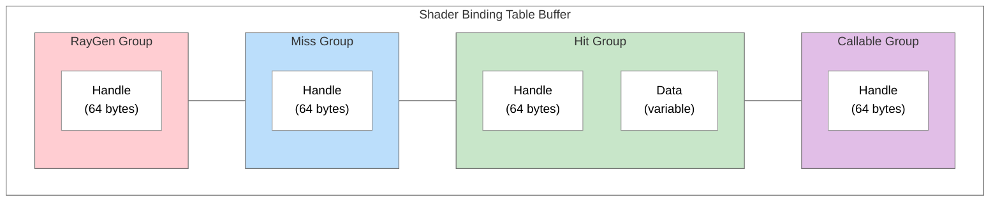
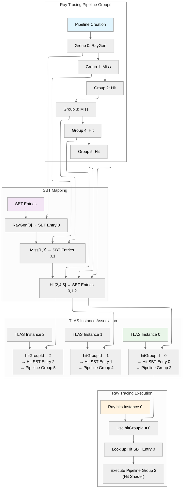
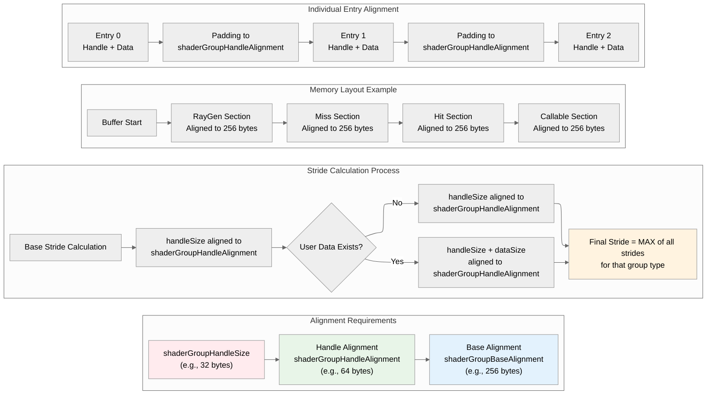

## 概述

着色器绑定表(Shader Binding Table,SBT)是 Vulkan 光线追踪中的一个基础组件,充当整个光线追踪过程的“蓝图”。在传统光栅化中,着色器是针对不同物体依次绑定的;而光线追踪则要求所有着色器同时可用,因为光线随时可能击中场景中的任何表面。

`nvvk::SBTGenerator` 类是一个辅助工具,用来简化创建和管理 SBT 这一复杂过程。它处理了缓冲区创建、对齐计算和着色器句柄获取等繁琐细节,让你更容易生成要存入 SBT 缓冲区的信息,并取得光线追踪器在调用 `vkCmdTraceRaysKHR` 时所用的句柄。

## 快速入门

下面是只用 5 步就让 SBT 工作起来的最精简代码:

```cpp
// 1. Initialize the SBT generator
nvvk::SBTGenerator sbtGen;
sbtGen.init(device, rayProperties);

// 2. Calculate required buffer size
size_t bufferSize = sbtGen.calculateSBTBufferSize(rtPipeline, pipelineInfo);

// 3. Create the SBT buffer
nvvk::Buffer sbtBuffer;
allocator.createBuffer(sbtBuffer, bufferSize, 
    VK_BUFFER_USAGE_2_SHADER_BINDING_TABLE_BIT_KHR | VK_BUFFER_USAGE_2_SHADER_DEVICE_ADDRESS_BIT,
    VMA_MEMORY_USAGE_AUTO_PREFER_DEVICE,
    VMA_ALLOCATION_CREATE_MAPPED_BIT,
    sbtGen.getBufferAlignment());

// 4. Populate the SBT buffer with shader handles
sbtGen.populateSBTBuffer(sbtBuffer.address, bufferSize, sbtBuffer.mapping);

// 5. Use the SBT in ray tracing
vkCmdTraceRaysKHR(cmd, 
    &sbtGen.getSBTRegions().raygen,    // Ray generation shader
    &sbtGen.getSBTRegions().miss,      // Miss shader  
    &sbtGen.getSBTRegions().hit,       // Hit shader
    &sbtGen.getSBTRegions().callable,  // Callable shader (optional)
    width, height, 1);                 // Dimensions
```

**这段代码做了什么:**

- **第 1 步**:用你的设备和光线追踪属性来设置 SBT 生成器
- **第 2 步**:计算准确的内存需求(自动处理对齐)
- **第 3 步**:为 SBT 创建一个正确对齐的缓冲区
- **第 4 步**:用管线中的着色器句柄填充缓冲区
- **第 5 步**:用 SBT 和你的着色器来追踪光线

**前提条件:**

- 一个光线追踪管线的创建信息(`pipelineInfo`),也就是创建管线时用的那一个
- 一个带有着色器组的光线追踪管线(`rtPipeline`)
- 一个用于创建缓冲区的资源分配器(`allocator`)
- 从物理设备获取的光线追踪属性(`rayProperties`)

这套最精简的设置处理了所有复杂的对齐要求,能给你一个可用的 SBT。自定义数据、多个着色器组、性能优化等高级功能,请参见后面各节。

## 作用与功能

借助 SBT,我们可以:

- 选择使用哪个光线生成着色器(raygen)作为入口点
- 指定在没有找到任何交点时执行哪个未命中着色器(miss)
- 定义每个实例可以执行哪些命中着色器组
- 通过 TLAS 中的 `hitGroupId` 把实例和特定的着色器组关联起来

构建并填充 SBT,只是告诉实现着色器记录(shader record)位于内存中的*什么位置*;运行时仍然需要为每一次相交*挑选出正确的记录*。对于**最近命中着色器(closest-hit)**和**任意命中着色器(any-hit)**,Vulkan 规范定义了这个地址的计算方式,它由以下几部分共同决定:你传给 `vkCmdTraceRaysKHR` 的命中区域、TLAS 中的实例数据、每个 BLAS 内部几何体的顺序,以及着色语言中 `traceRayEXT`(或对应的 SPIR-V 指令)的参数。

**命中组记录地址(出自 [Vulkan 规范](https://docs.vulkan.org/spec/latest/chapters/raytracing.html#shader-binding-table)):** 设备用跨步区域(strided region)的基地址和步长,再乘以一个由加速结构和追踪调用共同拼出的索引,来解析出命中着色器绑定表记录:

```text
pHitShaderBindingTable->deviceAddress
  + pHitShaderBindingTable->stride
    × ( instanceShaderBindingTableRecordOffset
        + geometryIndex × sbtRecordStride
        + sbtRecordOffset )
```

**各部分的作用:**

| 项 | 作用 |
|------|------|
| **`pHitShaderBindingTable`(`deviceAddress`、`stride`)** | 它们来自你传给 [`vkCmdTraceRaysKHR`](https://registry.khronos.org/vulkan/specs/1.3-extensions/man/html/vkCmdTraceRaysKHR.html) 的**命中(hit)**区域 `VkStridedDeviceAddressRegionKHR`。它们描述 SBT 的命中部分位于何处,以及该部分中相邻 **SBT 记录**之间的字节步长(在满足对齐规则之后)。 |
| **`sbtRecordStride` 和 `sbtRecordOffset`** | 它们是 GLSL 中 **`traceRayEXT`**(SPIR-V 中的 **`OpTraceRayKHR`**)上同名的参数。它们相对于由实例索引和几何体索引选出的基准记录,选择命中组那组记录中的哪一个“槽位”——通常把 `sbtRecordStride` 设为一条命中记录的字节大小(句柄加上可选的用户数据),这样每个几何体或每种逻辑材质都会映射到各自不同的记录。 |
| **`instanceShaderBindingTableRecordOffset`** | 按实例存储在 **`VkAccelerationStructureInstanceKHR`** 中。你在**构建 TLAS** 时提供它:它被加进上面的公式,使不同实例可以指向命中 SBT 中不同的起始记录,与 `geometryIndex` 无关。 |
| **`geometryIndex`** | 在每个底层加速结构(BLAS)中,几何体按**构建顺序**隐式排序。**`VkAccelerationStructureBuildGeometryInfoKHR::geometryCount`** 给出它们的数量;**`pGeometries`** 或 **`ppGeometries`** 数组按该顺序定义第 **0**、**1**、…… 个几何体。在相交时,**`geometryIndex`** 标识被击中的是所引用 BLAS 中的哪一个几何体——因此你的命中组记录的布局必须与这个顺序保持一致(也要与构建每个几何体时使用的 `primitiveCount` / 多段布局保持一致)。 |

光线生成着色器和未命中着色器使用同一次派发中的 **raygen** 区域和 **miss** 区域;它们的寻址使用更简单的索引(不含实例项和几何体项)。如果用到了可调用着色器(callable),则从 **callable** 区域中取记录。对于命中,要把这个公式与每个 TLAS 实例选择管线命中组的方式结合起来看——本教程把这种关联概括为 **`hitGroupId`**——这样 **`instanceShaderBindingTableRecordOffset`**、**`geometryIndex`** 和 **`traceRayEXT`** 的参数才能与你打包进命中区域的记录一一对上。

> **译注**:举个例子,若 `sbtRecordOffset = 0`、`sbtRecordStride = 1`,某实例的 `instanceShaderBindingTableRecordOffset = 2`,光线击中了它所引用 BLAS 中的第 1 个几何体(`geometryIndex = 1`),那么使用的就是命中区域中的第 2 + 1×1 + 0 = 3 条记录,地址为 `deviceAddress + stride × 3`。注意规范中的 `sbtRecordStride` 是以“记录个数”为单位的乘数,真正的字节步长来自命中区域的 `stride`。

## SBT 的结构

SBT 最多由四个数组组成,每个数组包含指向着色器组(shader group)的句柄:

1. **光线生成(RayGen)**——光线追踪的入口点
2. **未命中(Miss)**——光线没有击中任何物体时执行
3. **命中(Hit)**——光线与几何体相交时执行
4. **可调用(Callable)**——可选的着色器,可以从其他着色器中调用

### 缓冲区布局



图意:SBT 缓冲区依次由 RayGen 组、Miss 组、Hit 组、Callable 组四段组成;每段中都有一个句柄(Handle,图中示例为 64 字节),Hit 组在句柄之后还可以附带大小可变的数据(Data)。

**注意:** 虽然从技术上讲所有类型的组都可以附带用户数据,但 **Hit 组才是附带数据的主要用例**(例如材质属性、逐实例数据)。RayGen、Miss 和 Callable 组通常只包含着色器句柄。

一个包含 raygen、miss 和 hit 着色器的例子(02_basic):


一个有两个 miss 着色器的例子(05_shadow_miss):


## 理解着色器组索引

**“索引”指的是什么?**

在 SBT 的语境下,“索引”是指**着色器组在光线追踪管线中的位置(下标)**。当你用多个着色器组创建管线时,每个组都会得到一个从 0 开始的连续索引。

**管线布局示例:**

```text
Pipeline Groups: [RayGen:0, Miss:1, Hit:2, Miss:3, Hit:4, Hit:5]
Group Types:     RayGen[0], Miss[1,3], Hit[2,4,5]
```

**为什么这很重要:**

- **SBT 映射**:SBT 把管线组索引映射到实际的着色器句柄
- **实例关联**:TLAS 实例用 `hitGroupId` 引用特定的 SBT 条目
- **着色器选择**:光线追踪器用这些索引决定执行哪个着色器

**索引是如何使用的:**

1. **自动发现**:`addIndices()` 会从管线创建信息中自动找出所有组索引
2. **手动控制**:`addIndex()` 允许手动指定索引,以实现自定义布局
3. **数据关联**:通过 `addData()` 把用户数据附加到特定索引上

**特殊情况:**

- **管线库支持**:使用管线库(pipeline library)时,索引会加上偏移以保证唯一
- **重复条目**:多个 SBT 条目可以引用同一个管线组(当需要搭配不同数据时很有用)



图意:管线创建出组 0(RayGen)、组 1/3(Miss)、组 2/4/5(Hit);在 SBT 中,RayGen[0] 映射为 RayGen 区的条目 0,Miss[1,3] 映射为 Miss 区的条目 0、1,Hit[2,4,5] 映射为 Hit 区的条目 0、1、2;TLAS 实例 0/1/2 分别使用 `hitGroupId` 0/1/2,对应 Hit 区条目 0/1/2,即管线组 2/4/5。执行时,光线击中实例 0 → 使用 `hitGroupId = 0` → 查找 Hit 区条目 0 → 执行管线组 2(命中着色器)。

## 关键属性与对齐

SBT 依赖以下几个 Vulkan 光线追踪属性:

- **`shaderGroupHandleSize`**——程序标识符(句柄)的大小
- **`shaderGroupHandleAlignment`**——每个 SBT 条目的对齐字节数
- **`shaderGroupBaseAlignment`**——每个组起始地址的对齐字节数

### 对齐规则

1. **RayGen 组**:必须按 `shaderGroupBaseAlignment` 对齐
2. **所有组**:起始地址必须按 `shaderGroupBaseAlignment` 对齐
3. **单个条目**:必须按 `shaderGroupHandleAlignment` 对齐
4. **RayGen 步长**:必须等于其大小(特殊情况)



图意:四部分内容——① 对齐要求:句柄大小(例如 32 字节)、句柄对齐(例如 64 字节)、基址对齐(例如 256 字节);② 步长计算:先把 `handleSize` 按句柄对齐取整,若有用户数据则改为 `handleSize + dataSize` 按句柄对齐取整,最终步长取该组类型中所有步长的最大值;③ 内存布局示例:从缓冲区起点开始,RayGen、Miss、Hit、Callable 各段都按 256 字节对齐;④ 单个条目对齐:每个条目(句柄 + 数据)之后填充到 `shaderGroupHandleAlignment` 的边界。

### 大小计算公式

```cpp
// For each group type
stride = align_up(handleSize + dataSize, shaderGroupHandleAlignment);
size = align_up(count * stride, shaderGroupBaseAlignment);

// Total buffer size
totalSize = align_up(raygenSize, bufferAlignment) +
            align_up(missSize, bufferAlignment) +
            align_up(hitSize, bufferAlignment) +
            align_up(callableSize, bufferAlignment);
```

**为什么步长很重要:**

1. **统一的条目大小**:同一组内的所有条目必须大小相同,光线追踪器才能正确计算偏移
2. **数据对齐**:每个条目都按 `shaderGroupHandleAlignment` 对齐,以保证内存访问正确
3. **RayGen 特殊情况**:RayGen 的步长必须按 `shaderGroupBaseAlignment` 对齐,因为它是入口点

**步长计算过程:**

1. **基础步长**:从按 `handleAlignment` 对齐后的 `handleSize` 开始
2. **数据步长**:如果有用户数据,计算按 `handleAlignment` 对齐后的 `handleSize + dataSize`
3. **最终步长**:取该组类型所有步长中的最大值
4. **组对齐**:每个组所在的段都按 `shaderGroupBaseAlignment` 对齐

## SBT 的生成过程

`nvvk::SBTGenerator` 类是一个辅助工具,用来简化创建和管理着色器绑定表这一复杂过程。它处理了缓冲区创建、对齐计算和着色器句柄获取等繁琐细节,让你更容易生成要存入 SBT 缓冲区的信息。

### 1. 初始化

```cpp
SBTGenerator sbtGenerator;
sbtGenerator.init(device, rayProperties);
```

### 2. 计算缓冲区大小

```cpp
size_t bufferSize = sbtGenerator.calculateSBTBufferSize(
    rtPipeline, rayPipelineInfo, librariesInfo);
```

它会计算:

- 所需的缓冲区大小
- 每种组类型的步长
- 每个组在缓冲区中的偏移
- 总的内存需求

**内部发生了什么:**

1. **发现组索引**:函数分析管线,找出每种类型的着色器组所在的位置(索引):
   - **RayGen 组**:包含光线生成着色器的组
   - **Miss 组**:包含未命中着色器的组
   - **Hit 组**:包含最近命中、任意命中或相交着色器(intersection)的组
   - **Callable 组**:包含可调用着色器的组

2. **计算步长**:为每种组类型计算所需的步长:
   - **基础步长**:按 `shaderGroupHandleAlignment` 对齐后的 `handleSize`
   - **数据步长**:如果附带了用户数据,步长变为按 `shaderGroupHandleAlignment` 对齐后的 `handleSize + dataSize`
   - **最终步长**:该组类型所有步长中的最大值
   - **特殊情况**:RayGen 的步长必须按 `shaderGroupBaseAlignment` 对齐

3. **缓冲区布局**:每个组所在的段都按 `shaderGroupBaseAlignment` 对齐,确保光线追踪器能得到正确的内存布局。

### 3. 创建缓冲区

```cpp
// Create SBT buffer with proper usage flags
VkBufferUsageFlags usage = VK_BUFFER_USAGE_2_SHADER_BINDING_TABLE_BIT_KHR |
                           VK_BUFFER_USAGE_2_SHADER_DEVICE_ADDRESS_BIT;

allocator.createBuffer(sbtBuffer, bufferSize, usage, 
                      VMA_MEMORY_USAGE_AUTO_PREFER_DEVICE,
                      VMA_ALLOCATION_CREATE_MAPPED_BIT,
                      sbtGenerator.getBufferAlignment());
```

**重要:** 用户需要自己根据 `calculateSBTBufferSize()` 提供的大小和对齐信息来创建缓冲区。SBT 生成器只负责计算需求并填充缓冲区——它本身不会创建缓冲区。

### 4. 填充 SBT

```cpp
sbtGenerator.populateSBTBuffer(sbtBuffer.address, bufferSize, sbtBuffer.mapping);
```

这个过程会:

- 从管线中取得着色器句柄
- 把句柄复制到 SBT 缓冲区
- 写入用户提供的数据(如果有)
- 计算最终的设备地址

**技术细节:**

1. **获取句柄**:用 `vkGetRayTracingShaderGroupHandlesKHR` 从管线取得所有着色器句柄
2. **填充缓冲区**:对每种组类型,把句柄和可选的用户数据写入缓冲区:
   - **句柄**:着色器程序标识符(总是存在)
   - **用户数据**:通过 `addData()` 附加的额外数据(可选)
   - **步长**:每个条目都会被填充到该组类型计算出的步长
3. **计算地址**:把缓冲区偏移转换成完整的设备地址,供 `vkCmdTraceRaysKHR` 使用

缓冲区中包含了所有必需的数据,而提供给光线追踪器的句柄则指明了光线追踪器应该访问缓冲区中的哪个位置。

## SBT 的高级功能

### 附加自定义数据

SBT 可以在着色器句柄旁边存放自定义数据:

```cpp
struct HitRecordBuffer {
    std::array<float, 4> color;
};

// Add data to specific hit groups
sbtGenerator.addData(SBTGenerator::eHit, 0, hitData0);
sbtGenerator.addData(SBTGenerator::eHit, 1, hitData1);
```

示例请参见教程 07_multi_closest_hit。

### 多个着色器组

通过复制条目,SBT 中的条目可以比管线组还多:

```cpp
// Pipeline has 2 hit groups, but SBT has 3
sbtGenerator.addIndices(rayPipelineInfo);  // Add groups 0, 1
sbtGenerator.addIndex(SBTGenerator::eHit, 2);  // Duplicate group 1
sbtGenerator.addData(SBTGenerator::eHit, 2, customData);  // Custom data for entry 2
```

示例请参见教程 07_multi_closest_hit。

### 手动指定组索引

不使用 `addIndices()`,你也可以手动指定组索引,以获得完全的控制:

```cpp
// Manually define group indices
sbtGenerator.addIndex(SBTGenerator::eRaygen, 0);   // RayGen group 0
sbtGenerator.addIndex(SBTGenerator::eMiss, 1);     // Miss group 1
sbtGenerator.addIndex(SBTGenerator::eMiss, 2);     // Miss group 2
sbtGenerator.addIndex(SBTGenerator::eHit, 3);      // Hit group 3
sbtGenerator.addIndex(SBTGenerator::eHit, 4);      // Hit group 4

// Add custom data to specific groups
sbtGenerator.addData(SBTGenerator::eHit, 3, hitData0);
sbtGenerator.addData(SBTGenerator::eHit, 4, hitData1);
```

### 管线库支持

SBT 生成器支持管线库:

```cpp
std::vector<VkRayTracingPipelineCreateInfoKHR> libraries = {lib1, lib2};
sbtGenerator.addIndices(rayPipelineInfo, libraries);
```

## 在光线追踪中使用

### 获取 SBT 区域

```cpp
const SBTGenerator::Regions sbtRegions = sbtGenerator.getSBTRegions();

// Access individual regions
VkStridedDeviceAddressRegionKHR raygenRegion = sbtRegions.raygen;
VkStridedDeviceAddressRegionKHR missRegion = sbtRegions.miss;
VkStridedDeviceAddressRegionKHR hitRegion = sbtRegions.hit;
VkStridedDeviceAddressRegionKHR callableRegion = sbtRegions.callable;
```

### 追踪光线

```cpp
vkCmdTraceRaysKHR(cmdBuffer,
                   &sbtRegions.raygen,    // Ray generation shader
                   &sbtRegions.miss,      // Miss shader
                   &sbtRegions.hit,       // Hit shader
                   &sbtRegions.callable,  // Callable shader
                   width, height, 1);     // Dimensions
```

## 最佳实践

1. **对齐**:始终遵守对齐要求,避免验证错误
2. **内存布局**:使用生成器计算出的偏移和步长
3. **性能**:在生产环境的应用中,考虑使用设备本地(device-local)内存
4. **调试**:在开发工具中为 SBT 缓冲区设置调试名称
5. **验证**:确保缓冲区大小与计算出的需求完全一致

## 常见陷阱

1. **忽视对齐**:没有对齐到要求的边界会导致验证失败
2. **缓冲区大小不匹配**:使用错误的缓冲区大小会导致未定义行为
3. **缺少用途标志**:忘了加 `VK_BUFFER_USAGE_2_SHADER_BINDING_TABLE_BIT_KHR`
4. **混淆步长**:RayGen 的步长必须等于其大小,其他组的步长可以不同
5. **句柄索引不匹配**:管线组与 SBT 条目之间的映射不正确
